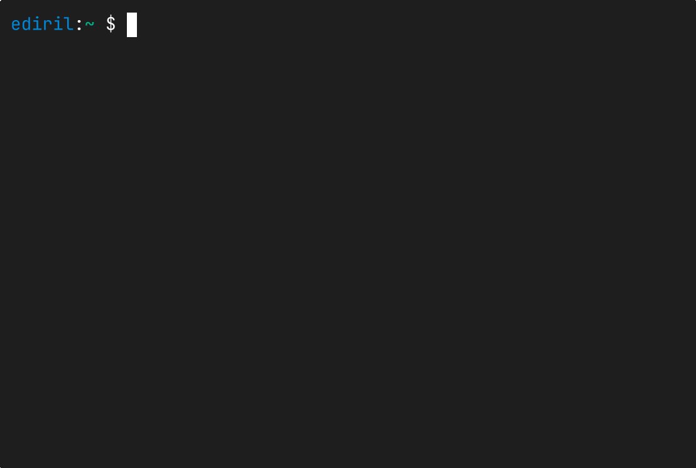

# HLSync

HLSync (`hlsync`) is a command-line workflow for deploying local
projects to shared hosting over explicit FTP over TLS (FTPS): map once, preview
the diff, then push the intended files.



HLSync is pre-alpha software. Commands and configuration may change before a
stable release.

## Who is it for?

HLSync is for people who still deploy websites or small projects to shared hosting over FTP.

If your current process is basically “figure out which files changed and upload them,” HLSync gives you a safer, more repeatable version of that workflow without requiring a full deployment system.

It works best when your local project is the source of truth and the remote server is simply where the project gets deployed.

## Installation

HLSync requires Python 3.10 or newer. Install it from PyPI as an isolated
command-line tool with uv:

```console
uv tool install hlsync
```

Upgrade later with:

```console
uv tool upgrade hlsync
```

The FTPS server must support explicit TLS with protected data connections
(`AUTH TLS` and `PROT P`). HLSync prefers MLSD listings; servers without MLSD
use Unix-style LIST listings with SIZE and MDTM for exact file metadata.
LIST mode includes dotfiles and requires two extra requests per file. Push additionally
requires MFMT (or writable MDTM on vsFTPd) and MDTM read-back to apply and verify
uploaded-file timestamps.

## Quick start

HLSync reads credentials from environment variables. The defaults are:

```text
PROD_FTPS_USERNAME
PROD_FTPS_PASSWORD
```

Set `PROD_FTPS_HOST` too and `create` can omit `--host`.

From the local project root:

```console
hlsync create prod --host ftp.example.com --remote-root /public_html/site
hlsync connect
hlsync exclude node_modules
hlsync diff
hlsync push
```

`create` proposes the current directory as the local root; pressing Enter accepts
it. Declining prompts for another local folder. Use `--local-root PATH` to
provide one directly. Both `diff` and `push` recurse by default. Use `-s` /
`--shallow` to process only the selected folder's immediate contents.

## Everyday commands

```console
hlsync profiles                  # list profiles; * marks the current one
hlsync cd staging                # go to a profile's folder (after hlsync setup)
hlsync exclude node_modules      # keep a path out of deployments
hlsync include 'static/*.webp'   # bring back Git-ignored files
hlsync rules                     # show rules and applied .gitignore patterns
hlsync list -r                   # local tree with exclusions marked
hlsync diff                      # what push would change, read-only
hlsync push --dry                # preview the exact push
hlsync push                      # upload new and changed files
hlsync pull index.html           # replace a local file from the server
```

HLSync honors `.gitignore` files automatically. Push never deletes remote files
unless you pass `-p` / `--prune`, and it stops before overwriting a file that is
newer on the server. Each upload is staged beside its destination and verified
before it replaces the live file.

## Documentation

- [Profiles and mapping](https://github.com/ediril/hlsync/blob/main/docs/profiles.md):
  profiles, credentials, local and remote roots, and running commands from
  anywhere.
- [Synchronization rules](https://github.com/ediril/hlsync/blob/main/docs/rules.md):
  `.gitignore` handling, common and profile rules, wildcards, and remote
  protection.
- [Paths, traversal, and listing](https://github.com/ediril/hlsync/blob/main/docs/paths-and-listing.md):
  how paths select files, recursion depth, and `list`.
- [Diff](https://github.com/ediril/hlsync/blob/main/docs/diff.md):
  status markers, pruning previews, and wider views.
- [Push and pull](https://github.com/ediril/hlsync/blob/main/docs/push-and-pull.md):
  conflicts, deletion, progress, and safe file replacement.
- [Development and maintenance](https://github.com/ediril/hlsync/blob/main/docs/development.md):
  testing local changes, switching installs, and releasing.

## Command behavior

Commands accept the shortest unique prefix. Exact names win. An ambiguous
prefix prompts for a numbered choice on an interactive terminal and fails with
the candidate list in noninteractive use.

Use `hlsync help [command]`, `hlsync version`, and `hlsync --legend` for
built-in reference. `hlsync v`, `hlsync -v`, and `hlsync --version` also print
the installed version.

## License

HLSync is source-available under the [PolyForm Strict License 1.0.0](https://github.com/ediril/hlsync/blob/main/LICENSE).
Use is free of charge for the purposes permitted by that license, including:

- Any noncommercial purpose.
- The personal uses listed in the license, such as personal study and hobby
  projects, without any anticipated commercial application.
- Use by charitable organizations, educational institutions, public research
  organizations, public safety or health organizations, environmental protection
  organizations, and government institutions, regardless of funding source or
  obligations resulting from funding.

This license grants no rights to modify or redistribute HLSync or create works
based on it. The full license governs; this summary does not grant additional
permissions.

Commercial use outside those permissions requires a separate paid license.
Contact [Emrah Diril](mailto:emrah@diril.org) for pricing and a commercial
agreement before beginning such use.
